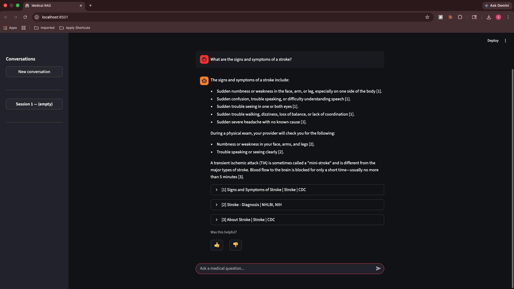
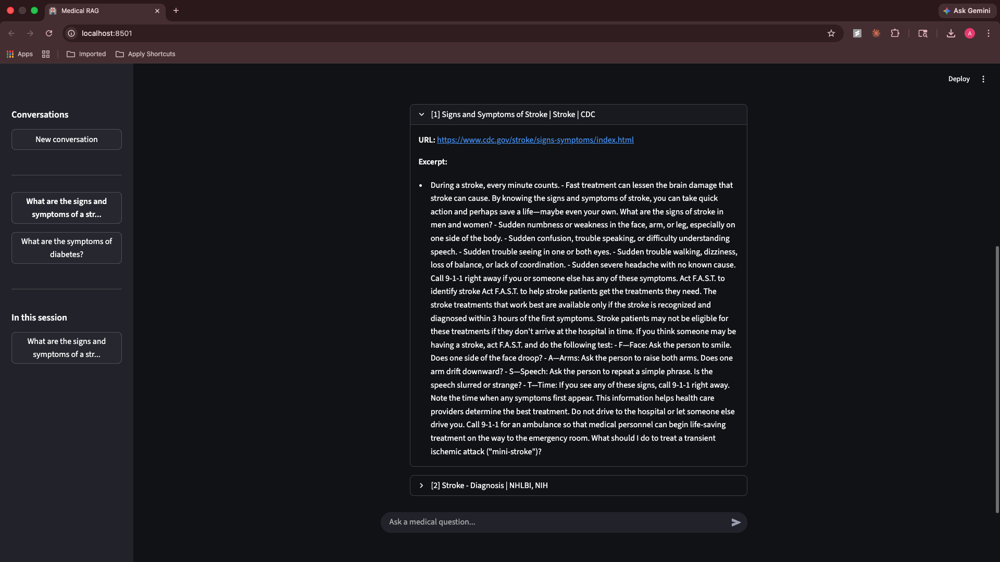
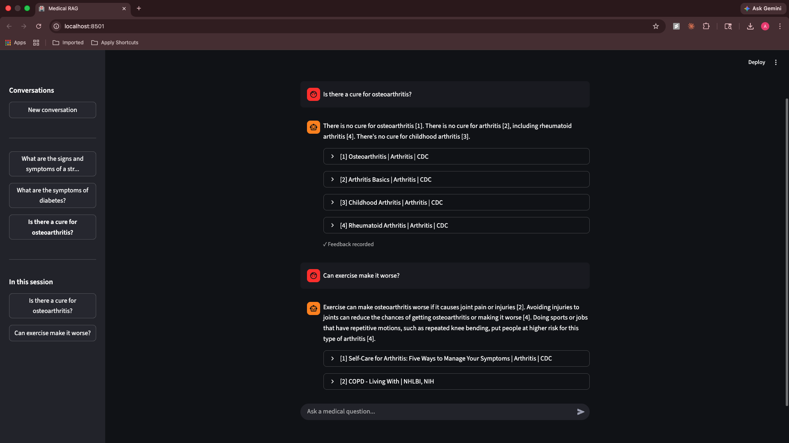
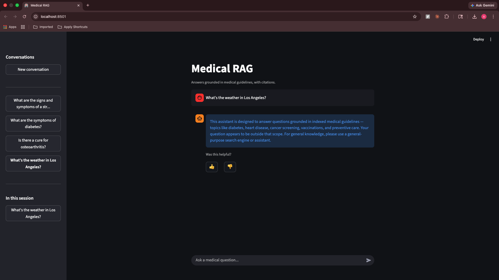
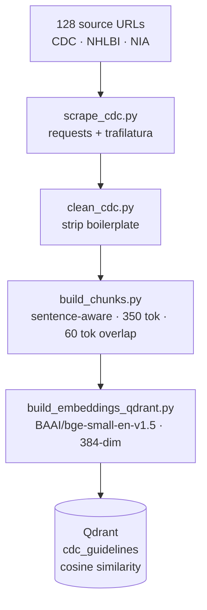
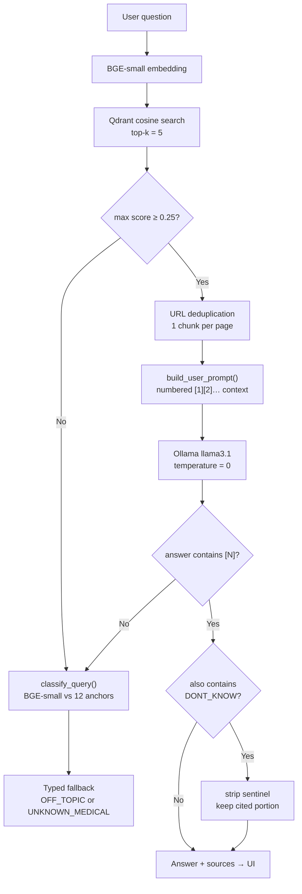

# Medical RAG

A retrieval-augmented generation system that answers chronic disease questions grounded exclusively in CDC, NHLBI, and NIA guidelines — with hard citation enforcement and no hallucination fallback.


---

## Screenshots

| Cited answer | Source expansion |
|---|---|
|  |  |

| Multi-turn conversation | Off-topic fallback |
|---|---|
|  |  |

---

## Architecture

### Ingestion pipeline



### Query pipeline



---

## Quick Start

### Prerequisites

- [Docker](https://docs.docker.com/get-docker/)
- [Ollama](https://ollama.com) running natively with `llama3.1` pulled

```bash
ollama pull llama3.1
```

> **Note:** Ollama runs on the host, not in Docker. The app container reaches it via `OLLAMA_URL` (defaults to `http://host.docker.internal:11434/api/chat` on Mac/Windows; set `http://172.17.0.1:11434/api/chat` on Linux).

### Setup

```bash
git clone <repo>
cd medical_rag

# Build the index (one-time — requires a local Python env)
python -m venv .venv && source .venv/bin/activate
pip install -r requirements.txt
docker compose up qdrant -d          # Qdrant only, for ingestion
python -m src.ingest.scrape_cdc
python -m src.ingest.clean_cdc
python -m scripts.build_chunks
python -m scripts.build_embeddings_qdrant
```

### Run

```bash
# Start the full stack (Qdrant + Streamlit app)
docker compose up
```

The app is available at `http://localhost:8501`. The embedding model (`BAAI/bge-small-en-v1.5`) is pre-baked into the image — no download on startup.

```bash
# CLI tools (local env, useful for eval and debugging)
python -m scripts.answer "What is the A1C target for adults with diabetes?"
python -m scripts.answer -i    # interactive multi-turn
```

---

## Evaluation Results

Benchmarked against 30 question/answer pairs spanning 12 medical topics. All questions were tested end-to-end through the full pipeline.

| Metric | Score | Detail |
|---|---|---|
| Answer rate | **100%** | 30 / 30 answered — zero silent failures |
| Retrieval recall | **93.3%** | 28 / 30 retrieved expected source URL |
| Citation rate | **100%** | 30 / 30 answers contain `[N]` markers |
| Keyword accuracy | **96.7%** | 29 / 30 contained expected answer keywords |
| Avg latency | **22.4 s** | Range: 9.8 s – 45.1 s (Ollama local, CPU) |

The two retrieval misses (`diabetes_003`, `hbp_003`) both retrieved factually correct content from alternate pages — the expected URL was marked incorrectly in the test set, not a pipeline failure. A 93.3% retrieval recall with a 100% answer rate means the system never fails silently: it either answers correctly or explicitly says it can't.

To reproduce:

```bash
python -m scripts.evaluate
# outputs aggregate table + data/eval/results.json
```

---

## Design Decisions

This section explains the non-obvious choices in the pipeline. Each one originated from a concrete failure observed during development — the full failure analysis is in [FINDINGS.md](FINDINGS.md).

### 1. Retrieval confidence gate

**What:** Before calling the LLM, check `max(scores) < 0.25`. If true, short-circuit and return a fallback — the LLM is never called.

**Why:** Qdrant's top-k retrieval always returns results, even when the query has no good match in the index. Without a gate, weakly-related chunks (cosine score 0.11) became hallucination scaffolding — the LLM produced fluent, confident-sounding answers grounded in irrelevant context. Inspecting score distributions for known-good vs. known-bad queries placed the threshold at 0.25: above it, the retrieved content is consistently relevant; below it, it's noise.

**Where:** `src/rag/pipeline.py:54`

---

### 2. Hard citation enforcement

**What:** After generation, check whether the LLM's response contains any `[N]` citation. If not, discard the answer entirely — replace it with a typed fallback, never show it.

**Why:** The system prompt instructs the model to cite every factual sentence, but instructions are soft. In practice the model occasionally returned a fluent, uncheckable answer when it "knew" the topic from training data. There was no programmatic way to distinguish a grounded response from a hallucinated one — until citation presence became a binary gate, not a preference. Citation rate in the benchmark: 100%, enforced in code, not learned.

**Where:** `src/rag/pipeline.py:64–72`

---

### 3. Sentence-aware chunking with overlap

**What:** Documents are split into sentences, packed greedily into ~350-token chunks, then each chunk is prefixed with the last 60 tokens of the previous one. Chunks below 80 tokens are merged into the preceding chunk.

**Why each parameter matters:**

| Parameter | Value | Reason |
|---|---|---|
| `target_tokens` | 350 | Fits comfortably in BGE-small's 512-token context with room for the query |
| `overlap_tokens` | 60 | Chunks that begin mid-sentence ("…which should be adjusted based on…") are self-contained only in the file, not in retrieval. Overlap duplicates boundary context into both chunks |
| `min_tokens` | 80 | CDC pages contain heading lines and nav-adjacent fragments ("**Prevention Tips**") that embed well on keyword overlap but carry no information. Merging them eliminates retrieval pollution without losing real short paragraphs |
| `max_tokens` | 450 | Hard ceiling; sentences longer than this are word-split with overlap rather than allowed to grow unbounded |

Token estimation uses whitespace-split, not a tokenizer — a deliberate tradeoff: stable, dependency-free, and accurate enough for sizing. A real tokenizer would produce more precise boundaries for medical abbreviations.

**Where:** `src/rag/chunking.py`, `ChunkConfig`

---

### 4. Query classification for typed fallbacks

**What:** When the confidence gate triggers (no good retrieval match), `classify_query()` determines whether the question is off-topic (weather, poetry) or in-scope-but-unindexed (rare disease). Each case gets a different message.

**Why:** A single "I don't know" response is actively misleading for two distinct failure modes. A user asking about a condition they expected to be covered deserves acknowledgment that the topic is real but not in this system's index. A user asking about the Super Bowl deserves to be redirected to a general assistant. Using the same BGE-small model already loaded for retrieval, the classifier computes cosine similarity against 12 medical anchor phrases. Similarity ≥ 0.55 → `UNKNOWN_MEDICAL`; below → `OFF_TOPIC`. The threshold was validated empirically via `scripts/test_classifier.py` against 8 labelled cases (4 off-topic, 4 medical).

**Where:** `src/rag/classify.py`, `pipeline.py:55–56`

---

### 5. URL deduplication before prompting

**What:** After Qdrant retrieval, keep only the highest-scoring chunk per unique URL. The deduplicated list becomes the numbered context block passed to the LLM.

**Why:** Qdrant returns the top-k most similar *chunks*, not pages. A single authoritative document — e.g. `cdc.gov/diabetes/about/index.html` — can fill all five slots. Without deduplication, citations `[1][2][3]` can point to three fragments of the same page, making the answer appear multi-sourced when it draws from a single document. Deduplication forces genuine diversity: each citation in the final answer maps to a distinct page.

**Where:** `src/rag/pipeline.py:37–46`

---

## Data Sources

| Source | Topics | URLs |
|---|---|---|
| [CDC](https://www.cdc.gov) | Diabetes, hypertension, cholesterol, obesity, stroke, COPD, arthritis, kidney disease, tobacco, alcohol, heart disease, Alzheimer's | ~108 pages |
| [NHLBI](https://www.nhlbi.nih.gov) | High BP treatment/pregnancy, COPD (diagnosis, treatment, prevention), coronary heart disease, cholesterol, obesity | 12 pages |
| [NIA](https://www.nia.nih.gov) | Alzheimer's / dementia (symptoms, diagnosis, prevention, treatment, behavior) | 8 pages |

Coverage expanded iteratively from CDC-only after observing that CDC pages for COPD, obesity, and Alzheimer's are intentionally high-level and lack clinical diagnostic specifics.

---

## Project Structure

```
medical_rag/
├── src/
│   ├── rag/
│   │   ├── pipeline.py     # Orchestration, confidence gate, citation check
│   │   ├── retrieve.py     # BGE-small embedding + Qdrant search
│   │   ├── generate.py     # Ollama llama3.1 call
│   │   ├── prompting.py    # System prompt + numbered context builder
│   │   ├── chunking.py     # Sentence-aware chunking with overlap
│   │   └── classify.py     # Off-topic vs unknown-medical classifier
│   ├── ingest/
│   │   ├── cdc_urls.py     # 128 source URLs (CDC + NHLBI + NIA)
│   │   ├── scrape_cdc.py   # Web scraper
│   │   └── clean_cdc.py    # Text cleaning
│   └── feedback.py         # SQLite thumbs-up/down logging
├── scripts/
│   ├── answer.py           # CLI query tool (single + interactive)
│   ├── evaluate.py         # 30-question benchmark
│   ├── build_chunks.py     # Chunk generation
│   └── build_embeddings_qdrant.py
├── data/
│   ├── docs/               # Raw, cleaned, and chunked documents
│   └── eval/               # qa_pairs.json + results.json
├── app.py                  # Streamlit UI with per-turn feedback
├── Dockerfile              # Python 3.12-slim, pre-bakes BGE-small model
├── docker-compose.yml      # Qdrant + app services (Ollama runs on host)
├── .dockerignore           # Excludes .venv, qdrant_data, raw_html, etc.
└── FINDINGS.md             # Failure analysis — 9 bugs found and fixed
```

---

## Feedback Loop

The Streamlit UI logs per-turn thumbs-up / thumbs-down ratings to a local SQLite database (`data/feedback.db`). Each row records the session, question, answer, and rating. This was built to support future fine-tuning or retrieval reranking using real preference signal — not just benchmark accuracy.

---

## What's Next

From the failure analysis in [FINDINGS.md](FINDINGS.md):

- **Re-ranking:** A cross-encoder pass after retrieval would improve precision for queries that embed similarly to multiple topics
- **Streaming output:** LLM responses are currently buffered before display; streaming would improve perceived latency at the Streamlit layer
- **Real tokenizer:** Replace whitespace-split with `tiktoken` for more precise chunk boundaries, especially for medical abbreviations
- **Broader coverage:** NIH MedlinePlus or SAMHSA sources would close the most common gaps (pharmacology, pediatric guidelines, mental health)
